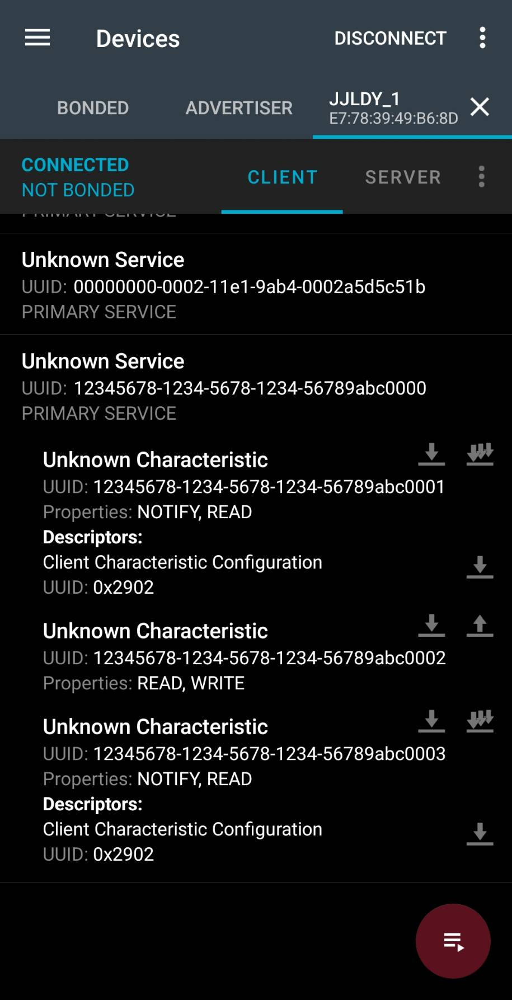
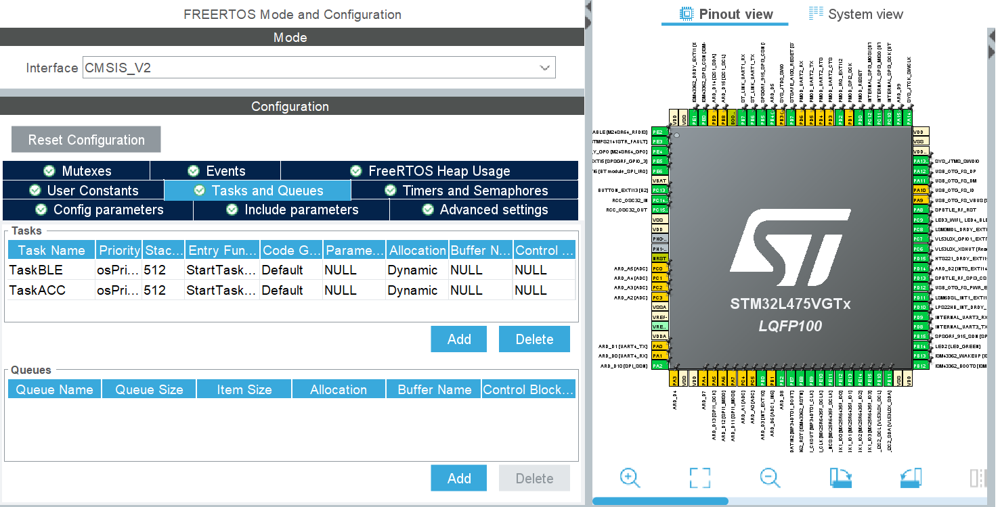
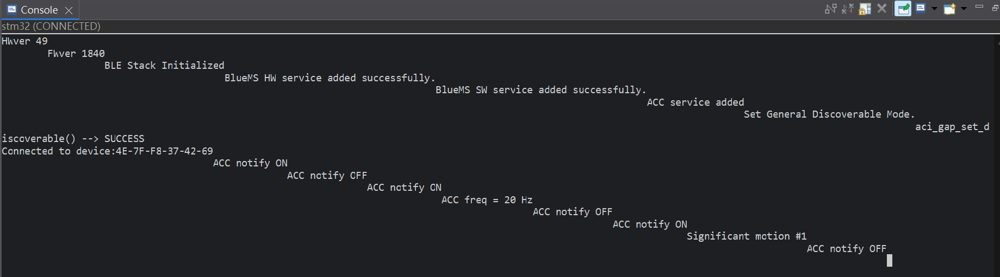
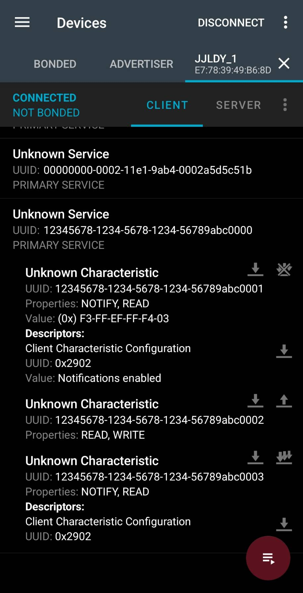

# Lab 4 — BLE GATT Server（STM32）與 GATT Client（Raspberry Pi + Python）

STM32 IoT node 擔任 **BLE Peripheral / GATT server**，提供自訂的加速度計 service；
Raspberry Pi 3 以 Python（bluepy）擔任 **BLE Central / GATT client**，寫入取樣頻率並接收加速度 notification。
STM32 端以 FreeRTOS 拆成 `TASK_BLE` 與 `TASK_ACC`，加速度為 LSM6DSL 實際量測值。
完成基本題與選作 (b) significant motion；選作 (a) 未做。

## 實作架構

```text
Raspberry Pi 3（Central / GATT client）            STM32 B-L475E-IOT01A（Peripheral / GATT server）
ble_acc_client.py（bluepy）                         廣播名稱 JJLDY_1
  1. 掃描，依名稱找到裝置              ◀── adv ──   Acc Service  12345678-1234-5678-1234-56789abc0000
  2. 連線、探索 GATT                   ── conn ──▶    ├ Char A …0001  加速度 x/y/z     [Read, Notify]
  3. 寫 Char B = 取樣頻率（Hz）        ─────────▶     ├ Char B …0002  取樣頻率 Hz      [Read, Write]
  4. 寫 Char A、C 的 CCCD = 01 00      ─────────▶     └ Char C …0003  significant motion 次數 [Read, Notify]
  5. 接收 notification                 ◀─────────
```

```text
STM32 內部
TASK_BLE：hci_user_evt_proc() → 連線 / 斷線 / GATT 寫入事件 → 更新頻率、CCCD 狀態；斷線後重新廣播
TASK_ACC：每 1/f 秒經 I²C2 讀 LSM6DSL → aci_gatt_update_char_value(Char A) → notify
LSM6DSL INT1 → PD11 / EXTI11 → osThreadFlagsSet() 叫醒 TASK_ACC → 讀 FUNC_SRC1 確認 → notify Char C
兩個 task 呼叫 BlueNRG ACI 前都要取得 bleMutex
```

- 硬體：B-L475E-IOT01A（STM32L475VG、SPBTLE-RF / BlueNRG-MS、LSM6DSL）。
- 開發環境：Windows 11、STM32CubeIDE 2.2.0、X-CUBE-BLE1 7.1.0、FreeRTOS（CMSIS-RTOS v2）。
- 基底：X-CUBE-BLE1 的 `SensorDemo_BLESensor-App` 範例；原本的模擬資料（`rand()`）不再使用。
- Pi：Raspberry Pi 3 Model B、Raspberry Pi OS Lite 64-bit、bluepy。以 SSH 操作。

## 檔案

| 路徑 | 說明 |
|---|---|
| `firmware/lab4-ble-2/` | 完整 STM32CubeIDE 專案（含 `.ioc`、HAL、BlueNRG-MS、FreeRTOS） |
| `firmware/lab4-ble-2/Core/Src/acc_service.c` | 主要實作：LSM6DSL、GATT service、`TASK_BLE` / `TASK_ACC` 本體、EXTI callback |
| `pi/ble_acc_client.py` | Pi 端 GATT client |
| `logs/client.log` | Pi 端執行紀錄（`--quiet` 模式） |
| `docs/screenshots/` | CubeMX、UART、手機 nRF Connect 截圖 |

`firmware/lab4-ble-2/README.md` 是 ST 範例原本附的說明，與本作業內容無關。

## GATT 設計

UUID 的 base 為 `12345678-1234-5678-1234-56789abcXXXX`，程式中以 little-endian 陣列存放。

| Characteristic | UUID | 長度 | 屬性 | 內容 |
|---|---|---|---|---|
| A：加速度 | `…0001` | 6 bytes | Read、Notify | x、y、z，各為 int16 little-endian，單位 mg |
| B：取樣頻率 | `…0002` | 2 bytes | Read、Write | uint16 little-endian，單位 Hz，範圍 1～100，預設 10 |
| C：significant motion | `…0003` | 2 bytes | Read、Notify | uint16，開機後偵測到的累計次數 |

BlueNRG 的 handle 規則：`charHandle + 1` 為 value，`charHandle + 2` 為 CCCD。
Char B 以 `GATT_NOTIFY_ATTRIBUTE_WRITE` 建立，client 寫入時會收到 `EVT_BLUE_GATT_ATTRIBUTE_MODIFIED`；
client 寫 A、C 的 CCCD 時也會收到同一個事件，程式藉此記錄 notify 是否開啟。

手機 nRF Connect 連線後看到的 service 與三個 characteristic：



## STM32 實作

### LSM6DSL

直接用 HAL I²C 讀寫暫存器（I²C2，位址 0xD4），不使用 BSP 感測器驅動，避免與 X-CUBE-BLE1 的 BSP 衝突。

| 暫存器 | 值 | 用途 |
|---|---|---|
| `WHO_AM_I` (0x0F) | 讀到 0x6A | 確認晶片 |
| `CTRL3_C` (0x12) | 0x44 | BDU=1、IF_INC=1 |
| `CTRL1_XL` (0x10) | 0x40 | ODR 104 Hz、±2 g（0.061 mg/LSB） |
| `OUTX_L_XL` (0x28) | 讀 6 bytes | X/Y/Z 原始值 |

### RTOS

| 元件 | 說明 |
|---|---|
| `TASK_BLE`（`TaskBLE`） | 每 5 ms 呼叫 `hci_user_evt_proc()`，處理 GAP 連線、斷線與 GATT 寫入；`set_connectable` 時重新廣播 |
| `TASK_ACC`（`TaskACC`） | 以 `osThreadFlagsWait()` 等到下次取樣時間；已連線且 CCCD 開啟時讀取並 notify |
| `bleMutex` | BlueNRG 的 ACI 不能同時被兩個 task 呼叫，兩個 task 在呼叫前都要取得 |
| Timebase | HAL 改用 TIM6，SysTick 留給 FreeRTOS；heap 20000 bytes、兩個 task stack 各 512 words |

`TASK_ACC` 的週期由 `next += 1000 / f` 累加計算，不隨處理時間漂移；落後超過 1 秒時重新對齊。
I²C 只在 `TASK_ACC` 使用，因此不需另外保護。



## 選作 (b)：Significant Motion

依 ST AN5040 的設定順序，在 `LSM6DSL_Init()` 開啟內建的 significant motion 偵測並導向 INT1：

| 暫存器 | 值 | 用途 |
|---|---|---|
| `CTRL10_C` (0x19) | 0x05 | FUNC_EN=1、SIGN_MOTION_EN=1 |
| `INT1_CTRL` (0x0D) | 0x40 | INT1_SIGN_MOT=1 |
| `FUNC_SRC1` (0x53) | 讀取 | bit 6 SIGN_MOTION_IA；讀取同時清除旗標 |

- INT1 接 PD11，CubeMX 已設為 EXTI11 上升緣觸發，NVIC 優先權 5，可在中斷中呼叫 FreeRTOS API。
- `HAL_GPIO_EXTI_Callback()` 只呼叫 `osThreadFlagsSet()`，不在中斷中做 I²C 或 BLE 操作。
- `TASK_ACC` 被 flag 提早叫醒時，讀 `FUNC_SRC1` 確認 bit 6，累加次數並更新 Char C；client 有訂閱就會收到 notification。
- 門檻使用預設值（SM_THS 未修改）。偵測以計步演算法為基礎，**拿著板子走路或規律上下搖晃數秒**才會觸發，單次晃動不會觸發。

## 主要修改檔案

| 檔案 | 修改內容 |
|---|---|
| `Core/Src/acc_service.c`、`Core/Inc/acc_service.h` | 新增檔案；LSM6DSL、GATT service、task 本體、EXTI callback |
| `Core/Src/main.c` | `StartTaskBLE()` / `StartTaskACC()` 的 USER CODE 區塊呼叫 `TaskBLE_Body()` / `TaskACC_Body()` |
| `BlueNRG_MS/App/app_bluenrg_ms.c` | `BlueNRG_MS_Init_PostTreatment` 區塊呼叫 `Add_Acc_Service()` |
| `BlueNRG_MS/App/sensor.c` | `user_notify()` 處理 `EVT_BLUE_GATT_ATTRIBUTE_MODIFIED`；斷線時關閉 notify 狀態 |
| `BlueNRG_MS/App/sensor.h` | 廣播名稱改為 `JJLDY_1` |
| `lab4-ble-2.ioc` | 開啟 FreeRTOS、兩個 task、`bleMutex`、TIM6 timebase、`BLE1_DEBUG=1` |

`sensor.c` 與 `sensor.h` 沒有 USER CODE 區塊，**CubeMX 重新產生程式碼後會被還原**，需重新套用上述修改。

## 執行

### 1. STM32

1. CubeIDE：File → Import → General → Existing Projects into Workspace，選取 `firmware/lab4-ble-2`。
2. Build，以 ST-LINK 的 micro-USB 連接板子後 Run 燒錄。
3. 用終端機開 ST-LINK Virtual COM Port（115200、8N1），按 RESET 應看到：

```text
BLE Stack Initialized
ACC service added
aci_gap_set_discoverable() --> SUCCESS
```

### 2. Raspberry Pi

```bash
sudo apt install -y python3-pip libglib2.0-dev
sudo pip3 install bluepy --break-system-packages
sudo python3 pi/ble_acc_client.py
```

| 參數 | 意義 |
|---|---|
| `--freq N` | 連線後寫入的取樣頻率，預設 10 |
| `--quiet` | 每秒只印一行（最新 x/y/z 與實際每秒 notification 數） |
| `--addr` | 指定 BLE 位址，跳過掃描 |
| `--name` / `--scan-time` | 掃描的裝置名稱 / 秒數 |

執行中輸入數字加 Enter 可改變取樣頻率，輸入 `q` 結束。
BlueNRG 同時只接受一個連線，執行前手機需先與板子斷線。

## 測試結果

以下項目都已在實體板子上確認：

| 測試 | 結果 |
|---|---|
| 手機 nRF Connect 連線、開啟 Char A notify | 數值持續更新，晃動或翻轉板子時三軸數值跟著變化 |
| 手機寫入 Char B | UART 印出新頻率，notify 更新速度改變 |
| Pi 執行 `ble_acc_client.py` | 收到加速度 notification；輸入新頻率後每秒 notification 數跟著改變 |
| 拿著板子走路（選作 b） | UART 印出 `Significant motion #n`，Pi 顯示 `*** SIGNIFICANT MOTION detected! ***` |

手機開啟 Char A notify 後收到的值 `F3-FF-EF-FF-F4-03`，依 little-endian int16 解讀為
x = -13、y = -17、z = 1012 mg，即板子平放時 z 軸約 1 g。

UART 輸出（板子開機 → 手機連線 → 開關 notify → 寫入 20 Hz → significant motion）：





Pi 端輸出（節錄，完整紀錄見 `logs/client.log`）：

```text
Found JJLDY_1: e7:78:39:49:b6:8d (random), RSSI=-58 dB
Connecting ...
Connected. Service and characteristics found.
>>> sampling frequency set to 10 Hz
Significant motion notifications enabled.
Notifications enabled. Type a frequency + Enter to change it, q to quit.

x=  -516  y=  -141  z=   882  (mg)   [10.3 notifications/s]

*** SIGNIFICANT MOTION detected! (#43) at 14:59:02 ***

x=   403  y=  -376  z=   194  (mg)   [9.8 notifications/s]
x=  -183  y=  -210  z=  -408  (mg)   [9.8 notifications/s]

*** SIGNIFICANT MOTION detected! (#44) at 14:59:04 ***
...
*** SIGNIFICANT MOTION detected! (#56) at 14:59:35 ***

x=  -522  y=  -232  z=   998  (mg)   [10.3 notifications/s]
x=    -6  y=    76  z=  1009  (mg)   [9.8 notifications/s]
x=    -5  y=    76  z=  1003  (mg)   [9.8 notifications/s]
```

- 設定 10 Hz 時，實際每秒收到 9.8～10.3 筆 notification。
- 約 35 秒的走動中觸發 14 次（#43～#56），間隔約 2～3 秒；偵測會自動重新啟動，不需韌體重新設定。
- 事件編號不是從 #1 開始，是因為次數從板子開機起累計，包含這次連線前的測試。
- 最後放下板子靜止時，三軸約為 (-6, 76, 1005) mg，合加速度約 1 g；晃動時 z 出現 1998 mg，已達 ±2 g 量程上限。

## 遇到的問題

- **`PRINTF` 未宣告**：`PRINTF` 是 `bluenrg_conf.h` 的巨集，`BLE1_DEBUG=0` 時為空；新檔案需 include 該標頭，並在 CubeMX 開 `BLE1_DEBUG`。
- **`case label value exceeds maximum value for type`**：新增的 `case` 放到內層 `switch` 的 `}` 之外，落入以 8-bit 事件碼判斷的外層 `switch`，永遠不會執行。
- **新增 service 的時機**：`Add_Acc_Service()` 必須放在 `PostTreatment`；放在 `PreTreatment` 時 BLE stack 尚未初始化。
- **廣播名稱長度**：`sensor.c` 的廣播資料把名稱長度固定為 7 字元，名稱需剛好 7 個字元，否則後面的廣播欄位錯位。
- **CubeMX 重新產生覆蓋 `sensor.c` / `sensor.h`**：自己的程式集中在 `acc_service.c`，其餘修改放在 USER CODE 區塊。
- **nRF Connect 的 Bond**：範例設定固定 PIN 123456，但本作業不需配對；直接 CONNECT 即可，Pi 端也不配對。
- **Pi 無法連上 Wi-Fi、開機 kernel panic**：原本的 Pi 3 在開機時出現 `Segmentation fault` 與 `Oops - Undefined instruction` 的 kernel panic，
  出錯位置每次不同，判斷為板子硬體不穩定；更換 Pi 3 後即可開機。
- **更換板子後停在 `(initramfs)`**：第一次開機在故障板子上中斷，SD 卡的 PARTUUID 已更新但 `cmdline.txt` 與 `/etc/fstab` 仍是舊值；
  在 initramfs 掛載兩個分割區，以 `sed` 改為新的 PARTUUID 後正常開機。
- **Pi 3 的 Wi-Fi**：只支援 2.4 GHz，手機熱點需設為 2.4 GHz、WPA2，名稱避免空格。
- **輸出捲動太快不易輸入**：終端機仍會收到輸入，另外加上 `--quiet` 選項。

## 限制

- 取樣頻率限制在 1～100 Hz；寫入超出範圍的值時韌體會夾住，但讀回 Char B 仍是原始寫入值。
- 高頻率時實際每秒 notification 數受 BLE connection interval 限制，可能低於設定值。
- 未使用配對與加密；characteristic 權限皆為 `ATTR_PERMISSION_NONE`。
- significant motion 次數存在 RAM，重新開機後歸零。
- 量程為 ±2 g，劇烈晃動時數值會在約 ±2000 mg 飽和；需要更大範圍時可把 `CTRL1_XL` 的 FS 改為 ±4 g 以上並調整換算係數。

## 參考與第三方程式

- ST X-CUBE-BLE1 7.1.0 `SensorDemo_BLESensor-App` 範例、BlueNRG-MS middleware，以及 STM32CubeL4 HAL / CMSIS、FreeRTOS。
- [LSM6DSL datasheet](https://www.st.com/resource/en/datasheet/lsm6dsl.pdf)
- [AN5040](https://www.st.com/resource/en/application_note/dm00402563-lsm6dsl-always-on-3d-accelerometer-and-3d-gyroscope-stmicroelectronics.pdf)
- [bluepy](https://github.com/IanHarvey/bluepy)

第三方程式保留其原有著作權及授權；請依各目錄授權檔與來源檔標頭使用。
